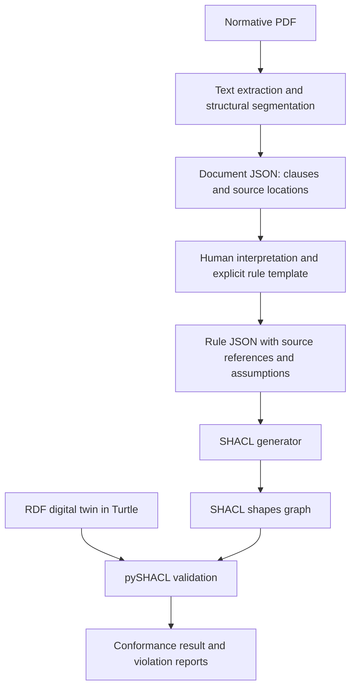

# SHACL and pySHACL for Normative Validation of Digital Twins

**Project:** ODOS — Ontology-Driven Operating System, AMOS WS 2026  
**Research task:** [Issue #11: Deep Dive on SHACL and pySHACL](https://github.com/amosproj/amos2026ws04-odos/issues/11)  
**Research date:** 1 November 2026  
**Deliverable:** Technical feasibility report and reproducible local demonstration

## Executive finding

**SHACL and pySHACL are feasible candidates for the validation layer of ODOS, provided that normative requirements have first been interpreted into explicit constraints and the digital twin supplies the required RDF data.**

The demonstration extracts all 83 pages of the supplied Musterbauordnung (MBO) PDF into JSON, attaches selected source clauses to manually interpreted rule JSON, generates SHACL, and validates small RDF digital twins. MBO §37(5) is represented through threshold and conditional constraints. A separate experiment implements the general calculation in §6(5), sentence 1, as `max(0.4 × H, 3)` using SHACL-SPARQL.

All **17 local test cases** produced their expected outcomes. An additional experiment changed the minimum width in JSON from 0.90 m to 1.00 m: the same 0.90 m-wide window changed from conforming to non-conforming, then passed again after restoring the original shapes. This demonstrates that the generated constraints control the result.

The result supports adopting SHACL as a candidate rule representation and pySHACL as an initial Python execution engine. It does **not** demonstrate automatic interpretation of arbitrary legal text, complete MBO coverage, correct real-world measurements, or production-scale performance. These are separate questions.

## 1. Project context and research scope

ODOS needs to check digital twins against applicable normative requirements. [Issue #6](https://github.com/amosproj/amos2026ws04-odos/issues/6) describes the goal of working with valid, regulation-compliant digital twins. The project also has a task for a consistent JSON representation of parsed normative documents, [Issue #12](https://github.com/amosproj/amos2026ws04-odos/issues/12). These goals motivate investigating how structured document content can feed executable checks.

Issue #11 asks for three research outcomes:

1. Explain what SHACL and pySHACL are, their creators, motivation, and users.
2. Represent MBO §37(5) as SHACL and execute it with pySHACL on a small example.
3. Document capabilities and limitations, including calculations such as `0.4 × height`.

The experiment is deliberately small enough to inspect. It uses a custom RDF vocabulary and selected clauses, rather than attempting to implement the complete ODOS application. Its JSON files are demonstration formats, **not a claim that the team has approved the final document or rule schema**.

## 2. Technology background

### 2.1 What SHACL is and who developed it

SHACL stands for **Shapes Constraint Language**. It expresses conditions on an RDF data graph using a second RDF graph containing shapes. The 2017 specification was developed by the **W3C RDF Data Shapes Working Group**, edited by **Holger Knublauch and Dimitris Kontokostas**, and published as a W3C Recommendation on **20 July 2017**. It is a community standard, rather than the invention of the ODOS project. [W3C SHACL Recommendation](https://www.w3.org/TR/2017/REC-shacl-20170720/)

This report uses the 2017 Recommendation as its technical baseline. As of the research date, W3C also publishes SHACL 1.2 work in progress; the Core document dated 30 October 2026 is a **Working Draft**, not a replacement Recommendation on which this demonstration depends. [W3C SHACL 1.2 Core draft](https://www.w3.org/TR/2026/WD-shacl12-core-20261030/)

### 2.2 Why a validation language was needed

RDF provides a flexible graph model, but an application still needs a contract for the information it expects. For example, receiving an RDF graph about a window does not by itself guarantee that a width has been supplied, that it is numeric, or that the value meets a threshold. A vocabulary describing concepts and an executable validation contract serve different purposes.

W3C's use-case document identifies application integration and producer/consumer interoperability as motivations: providers and consumers need shared, checkable expectations about exchanged data. It also distinguishes checking the expected structure from proving the truth of the data. [W3C SHACL Use Cases and Requirements, Scope and Motivation](https://www.w3.org/TR/shacl-ucr/#scope-and-motivation)

For ODOS, this means a digital twin can be checked against a defined set of requirements, while the correctness of measurements and the interpretation of the source remain separate responsibilities.

### 2.3 What pySHACL is and who developed it

**pySHACL is an open-source Python implementation of SHACL validation.** Its project documentation describes it as a validator for RDF graphs, built on RDFLib, and provides a Python API and command-line interface. Its purpose is to execute the standard within Python applications. [pySHACL project documentation](https://github.com/RDFLib/pySHACL)

The project identifies **Ashley Sommer as lead developer**. Its contributor list credits him with the main implementation; its citation metadata credits **Ashley Sommer and Nicholas Car**. The distinction matters: it is more precise to identify Sommer as the principal developer and Car as a credited contributor than to attribute the implementation equally to both. [Contributors](https://github.com/RDFLib/pySHACL/blob/master/CONTRIBUTORS.md), [citation metadata](https://github.com/RDFLib/pySHACL/blob/master/CITATION.cff)

Historical release documentation identifies Sommer and Car with **CSIRO Land & Water, Environmental Informatics Group**. These are historical affiliations; they should not be presented as their current positions. [pySHACL 0.29.1 release documentation, Contacts](https://pypi.org/project/pyshacl/0.29.1/)

SHACL's original motivation is general RDF validation. ODOS's motivation—reducing the effort of checking normative compliance—is a specific application of that technology, rather than the documented reason the standard was created.

### 2.4 Who uses it: two documented examples

| Project or organization | Primary evidence | What the evidence establishes | Relevance to ODOS |
|---|---|---|---|
| **BrickSchema / py-brickschema** | Its own repository documents `g.validate(engine="pyshacl")` and lists pySHACL as an available SHACL engine. [BrickSchema Python package](https://github.com/BrickSchema/py-brickschema#shacl-engines) | Direct integration of pySHACL into a building-model software package. It is an available engine; this report does not claim it is the current default. | Building data can be expressed as RDF and checked against graph constraints. This is technically close to the digital-twin validation problem. |
| **TERN, Australia's Terrestrial Ecosystem Research Network** | TERN's ontology documentation describes SHACL cardinality/type constraints and gives a `pyshacl -s tern.ttl -f human data.ttl` example. [TERN Conformance and Validation](https://linkeddata.tern.org.au/information-models/tern-ontology/dev-guide/conformance-and-validation) | Published guidance for validating TERN data with pySHACL. The page labels its content as draft; this is documented use guidance, not an independently verified production deployment. | Shows a domain data contract separating RDF input from reusable shapes, while acknowledging that domain-specific checks may need further implementation. |

The TERN content was available through its indexed official documentation; directly opening the dynamic page returned an incomplete shell during this review. The Brick integration was also checked against its own repository documentation. These examples establish concrete ecosystem use without treating popularity or download counts as proof of suitability for ODOS.

## 3. Proposed architecture and implemented data flow

Two information streams meet at the validator: the normative requirements supply constraints, and the digital twin supplies the facts to test.



The human-interpretation box is essential. Converting PDF text into JSON preserves content and organization; it does not automatically establish which object a rule applies to, which RDF property represents a term, or how exceptions should be encoded.

| Layer | Input → output | Implemented responsibility |
|---|---|---|
| Extraction, `extract()` | PDF → `output/document.json` | Retain all pages; segment section/subsection headings; record source fingerprint and page locations. |
| Interpretation attachment, `prepare_rules()` | Document JSON + `rules/template.json` → `output/rules.json` | Find selected clauses, check expected text fragments, and attach their source to the manually interpreted rules. |
| Generation, `prop()` / `compile_rules()` | Rule JSON → two `.ttl` shapes files | Map the supported rule fields into graph constraints and conditional branches. |
| Validation, `check()` | RDF data + shapes → reports | Check selected objects with pySHACL and save TXT, JSON and RDF results. |
| Experiments, `samples()` / `suite()` | Synthetic cases + expected outcomes → test results | Check boundaries, failures, missing information and the arithmetic example. |

JSON and SHACL therefore have different jobs. Document JSON stores normative content. Rule JSON stores an interpreted intermediate representation. SHACL is the executable graph constraint representation. The current validator accepts **Turtle `.ttl` files**, because the demonstration explicitly parses inputs with `format='turtle'`.

## 4. Source material, method and provenance

### 4.1 Input document

The source is the supplied [MusterBauVerordnung.pdf](MusterBauVerordnung.pdf), copied into this directory. Its cover identifies the Musterbauordnung, November 2002 edition, last amended by a Bauministerkonferenz decision dated 26/27 September 2024. The experiment refers to that local document version.

- Total pages extracted: **83**.
- Section headings segmented: **95**, including letter-suffixed sections.
- Main validation source: **§37(5), PDF page 34**.
- Arithmetic source: **§6(5), PDF page 10**; H is defined through §6(4).
- SHA-256 of the supplied PDF:

```text
53fd13388013263c3f676a3a8024f6932e38b8d326af6d2d844ecb9be61d340c
```

The fingerprint is stored in both document JSON and rule JSON. It identifies the exact file, but does not independently establish the authority or correctness of its content.

### 4.2 Extraction quality

PDFium extracts text from every page. Regular expressions identify standalone section headings and subsection markers. This is a heuristic parser, rather than a complete parser for every legal document layout.

One concrete extraction defect was found: the section sign before **§23, Zertifizierung**, was missing in extracted text on page 19. The segmentation input repairs that exact heading, and `known_segmentation_repairs` records the change. The retained page-text representation is not rewritten by this repair. The relevant pages for §37(5) and §6(5) were also rendered and visually inspected against the extracted clauses.

### 4.3 Method boundary

The normative-to-rule interpretation was performed manually for this demonstration and recorded in [the rule template](rules/template.json). No LLM was called. Source-fragment checks guard against an obvious source mismatch; they do not prove that a legal interpretation is correct. The generator supports the small rule vocabulary implemented in this demonstration, not arbitrary JSON documents.

## 5. MBO §37(5): formalization and example

### 5.1 Source meaning and modeling decisions

The paragraph concerns windows used as escape routes under §33(2), sentence 2. It states minimum clear dimensions of **0.90 m × 1.20 m**, a maximum position **1.20 m above the floor**, and an additional **1 m horizontal eaves-distance** condition for windows in roof slopes or roof structures. The original German text is retained in [rules.json](output/rules.json), under `source_clauses["37.5"]`.

The following mapping is the demonstration's interpretation of that clause:

| Requirement or data assumption | RDF representation | Executed condition |
|---|---|---|
| Escape-route applicability | `rdf:type ex:EscapeWindow` | Only objects classified into this target are checked. Applicability is supplied upstream. |
| First clear-opening dimension | `ex:clearWidthM` | Decimal value ≥ 0.90. |
| Second clear-opening dimension | `ex:clearHeightM` | Decimal value ≥ 1.20. |
| Opening height relative to finished floor | `ex:heightAboveFloorM` | Decimal value ≤ 1.20. |
| Roof applicability | `ex:inRoofSlopeOrRoofStructure` | Exactly one boolean value, including explicit `false` for ordinary windows. |
| Roof-window lower edge | `ex:lowerEdgeHorizontalDistanceToEavesM` | If this alternative is used, a decimal value ≤ 1.00. |
| Qualifying step in front of the window | `ex:stepHorizontalDistanceToEavesM` | Alternative to the lower-edge distance, with a decimal value ≤ 1.00. |

All lengths are in metres. The demonstration maps the first opening dimension to width and the second to height; it does not infer rotation. The interpretation of measurement positions and dimension orientation should be checked by the team with domain knowledge. The suitability of a platform is also assumed to have been assessed upstream.

The model additionally requires each used measurement to have exactly one value of the expected datatype. Nonnegative bounds on floor height and distances are data-quality safeguards. These are distinguished from the numerical thresholds stated in the source clause.

### 5.2 Example rule JSON

This is an actual field structure from the rule template:

```json
{
  "property": "clearWidthM",
  "datatype": "decimal",
  "minInclusive": "0.90",
  "message": "MBO 37(5): clear width >= 0.90 m (demo orientation mapping)."
}
```

The generator combines this with the target class and other constraints. It adds cardinality checks, translates the datatype to an XSD IRI, and writes the generated graph as Turtle. Source text and interpretation assumptions remain in the rule JSON for review.

### 5.3 Generated SHACL

The following is the complete generated window-shapes file used in the experiment. Its conditions are generated from the supported rule JSON fields; the compiler explicitly constructs the roof applicability and alternative-distance structure.

```turtle
@prefix ex: <https://example.org/amos/mbo#> .
@prefix rdf: <http://www.w3.org/1999/02/22-rdf-syntax-ns#> .
@prefix sh: <http://www.w3.org/ns/shacl#> .
@prefix xsd: <http://www.w3.org/2001/XMLSchema#> .

ex:EscapeWindowShape a sh:NodeShape ;
    sh:description "MBO section 37(5); see rules.json for source and interpretation assumptions." ;
    sh:or ( ex:NonRoofBranch ex:RoofBranch ) ;
    sh:property [ sh:datatype xsd:boolean ;
            sh:maxCount 1 ;
            sh:message "Data contract: roof applicability must be explicitly supplied as a boolean." ;
            sh:minCount 1 ;
            sh:path ex:inRoofSlopeOrRoofStructure ],
        [ sh:datatype xsd:decimal ;
            sh:maxCount 1 ;
            sh:message "MBO 37(5): clear height >= 1.20 m (demo orientation mapping)." ;
            sh:minCount 1 ;
            sh:minInclusive 1.20 ;
            sh:path ex:clearHeightM ],
        [ sh:datatype xsd:decimal ;
            sh:maxCount 1 ;
            sh:maxInclusive 1.20 ;
            sh:message "MBO 37(5): lower edge above floor <= 1.20 m; nonnegative is a data-contract check." ;
            sh:minCount 1 ;
            sh:minInclusive 0.0 ;
            sh:path ex:heightAboveFloorM ],
        [ sh:datatype xsd:decimal ;
            sh:maxCount 1 ;
            sh:message "MBO 37(5): clear width >= 0.90 m (demo orientation mapping)." ;
            sh:minCount 1 ;
            sh:minInclusive 0.90 ;
            sh:path ex:clearWidthM ] ;
    sh:targetClass ex:EscapeWindow .

ex:NonRoofBranch sh:property [ sh:hasValue false ;
            sh:maxCount 1 ;
            sh:message "inRoofSlopeOrRoofStructure" ;
            sh:minCount 1 ;
            sh:path ex:inRoofSlopeOrRoofStructure ] .

ex:RoofBranch sh:or ( [ sh:property [ sh:datatype xsd:decimal ;
                        sh:maxCount 1 ;
                        sh:maxInclusive 1.00 ;
                        sh:message "MBO 37(5) sentence 2: lower-edge horizontal distance to eaves <= 1 m." ;
                        sh:minCount 1 ;
                        sh:minInclusive 0.0 ;
                        sh:path ex:lowerEdgeHorizontalDistanceToEavesM ] ] [ sh:property [ sh:datatype xsd:decimal ;
                        sh:maxCount 1 ;
                        sh:maxInclusive 1.00 ;
                        sh:message "MBO 37(5) sentence 2: qualifying step horizontal distance to eaves <= 1 m." ;
                        sh:minCount 1 ;
                        sh:minInclusive 0.0 ;
                        sh:path ex:stepHorizontalDistanceToEavesM ] ] ) ;
    sh:property [ sh:hasValue true ;
            sh:maxCount 1 ;
            sh:message "inRoofSlopeOrRoofStructure" ;
            sh:minCount 1 ;
            sh:path ex:inRoofSlopeOrRoofStructure ] .
```

The outer `sh:or` accepts an ordinary window or the roof-window branch. In the roof branch, an inner `sh:or` accepts a qualifying lower-edge distance or a qualifying platform distance. This avoids incorrectly requiring both distances, and avoids imposing a roof-specific distance on ordinary windows.

### 5.4 RDF digital-twin input

This boundary-value example is [samples/valid_boundary.ttl](samples/valid_boundary.ttl):

```turtle
@prefix ex: <https://example.org/amos/mbo#> .

ex:valid_boundary a ex:EscapeWindow ;
    ex:clearWidthM 0.90 ;
    ex:clearHeightM 1.20 ;
    ex:heightAboveFloorM 1.20 ;
    ex:inRoofSlopeOrRoofStructure false .
```

Under the demonstration mapping, this input passes. Changing width to `0.89` makes it fail. Values are intentionally strict `xsd:decimal`: Turtle `0.90` is accepted, while a string `"0.90"` is rejected by the data contract. An integer such as `1` also differs from `1.00` in this contract.

### 5.5 pySHACL execution and observed violation

The execution path in [demo.py](demo.py) reads two RDF graphs and invokes the library:

```python
data = Graph().parse(data_file, format='turtle')
shapes = Graph().parse(shapes_file, format='turtle')
conforms, report, text = validate(
    data,
    shacl_graph=shapes,
    inference='none',
    meta_shacl=True,
)
```

`meta_shacl=True` also checks shapes against SHACL's metashapes; it does not establish semantic fidelity to the source paragraph. No optional inference is requested. The wrapper separately rejects input with no explicitly typed target objects.

The actual JSON result for the too-narrow example is:

```json
{
  "conforms": false,
  "target_count": 1,
  "results": [
    {
      "focus_node": "https://example.org/amos/mbo#too_narrow",
      "path": "https://example.org/amos/mbo#clearWidthM",
      "value": "0.89",
      "message": "MBO 37(5): clear width >= 0.90 m (demo orientation mapping).",
      "constraint": "http://www.w3.org/ns/shacl#MinInclusiveConstraintComponent"
    }
  ]
}
```

This is inspectable evidence: it identifies the focus object, the offending property, the observed value, and the failed constraint. The raw report is also saved as [TXT](output/reports/too_narrow.txt) and [RDF](output/reports/too_narrow.ttl).

## 6. Calculation experiment: `0.4 × H`

The calculation is from **§6(5), sentence 1**, rather than §37(5). The implemented general case is:

```text
required depth = max(0.4 × H, 3.0 m)
actual depth must be at least the required depth
```

The generated SHACL-SPARQL query finds violations:

```sparql
PREFIX ex: <https://example.org/amos/mbo#>
SELECT $this ?value WHERE {
  $this ex:effectiveHeightHM ?h ; ex:setbackDepthM ?value .
  BIND((0.4 * ?h) AS ?scaled)
  BIND(IF(?scaled > 3.0, ?scaled, 3.0) AS ?required)
  FILTER(?value < ?required)
}
```

The complete [setback shapes](output/setback_shapes.ttl) also require the input properties, numeric types and nonnegative values. This experiment establishes that the tested pySHACL configuration executes the required multiplication, comparison and minimum bound. It does not require the newer SHACL 1.2 Rules language or activation of optional rule inference.

For H=10 m, the required depth is 4 m: 4.00 m passes and 3.99 m fails. For H=5 m, the absolute minimum controls: 3.00 m passes and 2.99 m fails.

**Scope restriction:** `ex:GeneralSetbackCase` denotes an upstream-confirmed general case. The commercial/industrial-zone factor, residential exceptions and local-statute provisions in the rest of §6(5) are not implemented. H must already have been determined according to §6(4); the program does not calculate H from raw building geometry.

## 7. Empirical results and evidence

### 7.1 Environment

The recorded validation run used Python 3.13.15 on Linux. The package uses uv with locked dependencies and contains no required machine-specific paths. Python downloads are disabled by `uv.toml`. Versions are pinned in `pyproject.toml` and resolved in `uv.lock`.

| Component | Verified version |
|---|---|
| Python | 3.13.15 |
| uv | 0.12.3 |
| pySHACL | 0.40.1 |
| RDFLib | 7.6.0 |
| pypdfium2 | 5.14.0 |

The tested versions are a reproducibility baseline; this report does not claim they are the latest available releases. [Environment and artifact fingerprints](output/evidence/environment.json) record the run details.

### 7.2 Test matrix

The following table comes from [output/test_results.json](output/test_results.json). “Matched” means that the program returned the expected outcome, including expected rejections.

| RDF input | Expected | Observed | Test result |
|---|---|---|---|
| [valid_boundary.ttl](samples/valid_boundary.ttl) | true | true | Matched |
| [too_narrow.ttl](samples/too_narrow.ttl) | false | false | Matched |
| [too_short.ttl](samples/too_short.ttl) | false | false | Matched |
| [too_high.ttl](samples/too_high.ttl) | false | false | Matched |
| [missing_width.ttl](samples/missing_width.ttl) | false | false | Matched |
| [wrong_datatype.ttl](samples/wrong_datatype.ttl) | false | false | Matched |
| [wrong_boolean.ttl](samples/wrong_boolean.ttl) | false | false | Matched |
| [roof_edge_boundary.ttl](samples/roof_edge_boundary.ttl) | true | true | Matched |
| [roof_too_far.ttl](samples/roof_too_far.ttl) | false | false | Matched |
| [roof_missing_distance.ttl](samples/roof_missing_distance.ttl) | false | false | Matched |
| [roof_step_alternative.ttl](samples/roof_step_alternative.ttl) | true | true | Matched |
| [missing_roof_classification.ttl](samples/missing_roof_classification.ttl) | false | false | Matched |
| [setback_boundary.ttl](samples/setback_boundary.ttl) | true | true | Matched |
| [setback_too_small.ttl](samples/setback_too_small.ttl) | false | false | Matched |
| [setback_minimum.ttl](samples/setback_minimum.ttl) | true | true | Matched |
| [setback_below_minimum.ttl](samples/setback_below_minimum.ttl) | false | false | Matched |
| [no_target.ttl](samples/no_target.ttl) | Reject: no target | Rejected: no target | Matched |

Observed result: **17/17 expected outcomes matched**. The [captured test log](output/evidence/test-run.log) contains the actual command output. The input files and [manifest](samples/manifest.json) allow each case to be inspected and rerun.

### 7.3 JSON-to-SHACL mutation experiment

The test suite alone could demonstrate a working validator without proving that the intermediate JSON controls the generated threshold. A second experiment therefore kept the RDF input constant and changed the rule:

| Stage | Minimum width in rule JSON | Input width | Observed conformance |
|---|---|---|---|
| Baseline | 0.90 m | 0.90 m | `true` |
| Modified rule, regenerated shapes | 1.00 m | 0.90 m | `false` |
| Original shapes restored | 0.90 m | 0.90 m | `true` |

The modified message is updated together with the numerical threshold, so the report describes the changed rule correctly. Evidence includes the [modified rule JSON](output/evidence/threshold-1m-rules.json), [actual modified shapes](output/evidence/threshold-1m-shapes.ttl), and [recorded experiment results](output/evidence/threshold-experiment.json). The evidence script restores the original shape files byte for byte in a `finally` block.

### 7.4 What these results establish

The tests demonstrate the implemented constraint mappings, selected boundary conditions, negative cases and arithmetic capability. They provide concrete evidence that pySHACL is usable for this small ODOS validation scenario.

They do not measure false positives or false negatives over a real building corpus, legal-interpretation accuracy, large-graph runtime, or interchangeability across validation engines. Synthetic cases are useful for a feasibility decision but cannot establish those broader properties.

## 8. Capabilities, limitations and implications for ODOS

| Aspect | Evidence or limitation | Project implication |
|---|---|---|
| Fixed thresholds | Minimum/maximum boundary and failure cases behave as expected. | Suitable for explicitly quantified requirements. |
| Required fields and datatypes | Missing width and incorrect literal types are rejected. | Can validate both the input contract and selected normative requirements. |
| Conditional applicability | Roof classification selects the additional condition; platform alternative is supported. | Applicability and exceptions must be modeled explicitly. |
| Calculations | `max(0.4 × H, 3)` works through the tested SPARQL constraint. | Arithmetic is feasible; do not reject the stack simply because Core has no dedicated multiplication field. |
| Natural-language interpretation | Manual template, no automatic interpretation implemented. | A separate reviewed authoring/extraction process is needed. |
| RDF vocabulary and units | Custom classes/properties and metre-based decimals are assumed. | Agree mappings and unit normalization before integrating real twins. |
| Coverage and targeting | No-target graphs are rejected, but unclassified objects in a mixed graph remain outside the target set. | Track assessed, out-of-scope and unclassified objects; a pass must have a defined coverage scope. |
| Missing evidence | Required missing values produce non-conformance, which need not mean a physical object is non-compliant. | User-facing results should distinguish missing data from an observed threshold breach. |
| Input integrity | Validation tests supplied graph statements, not physical reality. | Geometry extraction and measurement quality need separate checks. |
| Rule provenance | JSON retains source clauses and file fingerprint; shapes contain descriptions. | A production design should propagate persistent source/version identifiers into shapes and reports. |
| Explainability | Property violations identify object, path and value; nested `sh:or` failures can be less specific at the top level. | A UI may need to inspect detailed RDF reports and translate branch failures into domain language. |
| Full regulation coverage | Only §37(5) under stated assumptions and §6(5) sentence 1 general case are modeled. | Do not label a passing result “MBO compliant” without stating covered rules. |
| Scale and alternatives | No large-graph benchmark or multi-engine comparison performed. | Production engine selection remains open if workload requirements justify further evaluation. |

No blocker was found for executing the selected modeled constraints. The main unresolved work is domain interpretation, input mapping and coverage, rather than the elementary ability to run graph constraints.

## 9. Adoption recommendation

**Use SHACL plus pySHACL as the initial validation approach for an ODOS prototype, subject to team agreement on the RDF input model and reviewed rule definitions.**

A practical integration would retain three distinct artifacts: the source document representation, the reviewed rule representation, and the generated executable shapes. This preserves the existing role of JSON and makes it possible to review an interpretation without treating the PDF parser as a legal reasoning component.

The validation boundary should accept an RDF data graph, an approved shape set and their versions, then return conformance, coverage and structured findings. It should also separate execution errors, missing information and genuine threshold breaches. The current local wrapper demonstrates the core execution path, while the richer service interface is a proposed integration design rather than implemented project functionality.

This task does not require building a general automatic PDF-to-SHACL system. The feasibility evidence is sufficient to support a team decision about using the technology for the next prototype step. Formal domain review is still needed before relying on the modeled constraints for real assessments.

## 10. Reproducing and modifying the demonstration

Run from the directory containing `pyproject.toml`:

```bash
uv run demo.py
```

This performs the complete extraction/generation/sample/test flow. It overwrites generated files under `output/` and `samples/`; keep personal experiments in separate files.

To test a custom twin:

```bash
cp samples/valid_boundary.ttl my-window.ttl
# Edit the copied RDF, for example change clearWidthM to 0.80.
uv run demo.py validate --data my-window.ttl
```

A conforming input exits with code 0. A non-conforming input exits with code 1. The latest custom results are written to `output/reports/custom.{json,txt,ttl}`. Invalid input or an empty target set raises an error rather than returning an ordinary conformance result.

To change the rule and regenerate shapes:

```bash
cp output/rules.json my-rules.json
# Change the width threshold and its message in the copied JSON.
uv run demo.py compile --rules my-rules.json
uv run demo.py validate --data my-window.ttl
```

To run the arithmetic example:

```bash
uv run demo.py validate \
  --data samples/setback_too_small.ttl \
  --shapes output/setback_shapes.ttl
```

To restore the template-based generated files and reproduce the research evidence:

```bash
uv run demo.py
uv run collect_evidence.py
```

The evidence command first checks the current shapes against the suite, verifies provenance, performs the threshold experiment, and restores the shapes. It assumes the original demo rule set; intentionally changed rules may cause the original expected-outcome suite to fail.

A contributor needs Python ≥3.12 and uv. Run `uv sync --locked` to install the locked dependencies; `python-downloads="never"` intentionally prevents automatic interpreter downloads. The environment was tested on Linux, not certified on other platforms.

## 11. Acceptance-criteria closure

| Issue #11 acceptance criterion | Delivered evidence | Research status |
|---|---|---|
| What it is, who created it, why, who uses it | Section 2; W3C, developer metadata and two primary-source usage examples. | Completed. |
| MBO §37(5) as SHACL and run with pySHACL | Section 5; source-linked rule JSON, complete generated shape, editable RDF samples and actual reports. | Completed within documented modeling assumptions. |
| Record capabilities and limitations, including calculations | Sections 6–9; arithmetic experiment, positive/negative tests, interpretation and scope limitations. | Completed. |

**The technical research deliverables are complete and ready for team review.** The issue's general DoD also mentions mainline merge, product-owner approval and developer release agreement. This local research package does not assert that those team actions have occurred, nor does its test suite replace repository-wide checks.

The team presentation is available in [presentation/AMOS_SHACL_Research.pptx](presentation/AMOS_SHACL_Research.pptx). Repository transfer guidance is in [HANDOFF.md](HANDOFF.md).

## 12. References and evidence index

### External primary sources

All web sources were checked on 1 November 2026. Moving repository pages may change; fixed dates/versions are used where relevant.

1. [ODOS Issue #11 — Deep Dive on SHACL and pySHACL](https://github.com/amosproj/amos2026ws04-odos/issues/11). Task question and acceptance criteria.
2. [ODOS Issue #6 — Enforce Integrity and Compliance of Digital Twins](https://github.com/amosproj/amos2026ws04-odos/issues/6). Project validation objective.
3. [ODOS Issue #12 — Create a JSON Schema for Normative Documents](https://github.com/amosproj/amos2026ws04-odos/issues/12). Document representation context.
4. [W3C — Shapes Constraint Language, Recommendation, 20 July 2017](https://www.w3.org/TR/2017/REC-shacl-20170720/). Standard baseline and working-group origin.
5. [W3C — SHACL Use Cases and Requirements](https://www.w3.org/TR/shacl-ucr/). Validation motivation and application integration.
6. [W3C — SHACL 1.2 Core, Working Draft, 30 October 2026](https://www.w3.org/TR/2026/WD-shacl12-core-20261030/). Distinguishes ongoing development from the baseline Recommendation.
7. [RDFLib/pySHACL — project documentation](https://github.com/RDFLib/pySHACL). Library purpose and API.
8. [RDFLib/pySHACL — contributors](https://github.com/RDFLib/pySHACL/blob/master/CONTRIBUTORS.md) and [citation metadata](https://github.com/RDFLib/pySHACL/blob/master/CITATION.cff). Principal implementation and credited authors.
9. [PyPI — pySHACL 0.29.1](https://pypi.org/project/pyshacl/0.29.1/). Historical CSIRO affiliations; not a current-employer assertion.
10. [BrickSchema/py-brickschema — SHACL engines](https://github.com/BrickSchema/py-brickschema#shacl-engines). Direct integration and explicit pySHACL selection.
11. [TERN — Conformance and Validation](https://linkeddata.tern.org.au/information-models/tern-ontology/dev-guide/conformance-and-validation). Official draft documentation of SHACL constraints and pySHACL usage; indexed content consulted because direct page retrieval was incomplete.

### Local implementation and empirical evidence

| Artifact | Purpose |
|---|---|
| [Supplied PDF](MusterBauVerordnung.pdf) | Version-specific normative source. |
| [demo.py](demo.py) | Extraction, rule attachment, generation, validation and tests. |
| [README.md](README.md) | Setup, usage and repository handoff instructions in English. |
| [Rule template](rules/template.json) | Explicit human interpretation and assumptions. |
| [Full document JSON](output/document.json) | All page text and heuristic document structure. |
| [Source-linked rule JSON](output/rules.json) | Selected rules, original clauses, pages and fingerprint. |
| [Window shapes](output/window_shapes.ttl) / [setback shapes](output/setback_shapes.ttl) | Executable constraints. |
| [Test manifest](samples/manifest.json) / [test outcomes](output/test_results.json) | Cases and expected/observed results. |
| [Test log](output/evidence/test-run.log) | Captured execution output. |
| [Evidence collector](collect_evidence.py) | Reproduces provenance assertions and the threshold experiment. |
| [Environment metadata](output/evidence/environment.json) | Runtime versions, time and artifact SHA-256 values. |
| [Threshold experiment](output/evidence/threshold-experiment.json) | Baseline, modified and restored outcomes. |
| [Modified rules](output/evidence/threshold-1m-rules.json) / [modified shapes](output/evidence/threshold-1m-shapes.ttl) | Inspectable mutation inputs and generated constraint graph. |


