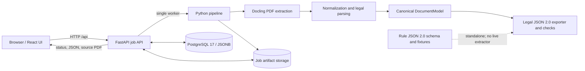

# ODOS - Technical Design Documentation

**Version:** 1.0 (Sprint 06 baseline)  
**As of:** 21 November 2026  
**Reference:** Uploaded `amos2026ws04-odos-main.zip` (main-branch snapshot)  
**Audience:** Developers, reviewers, and new team members  
**Maintenance:** Living design document; update alongside architectural or contract changes.

> **Implementation boundary:** This document describes the code present in the referenced main-branch snapshot, not every feature proposed for ODOS. PDF-to-Legal-JSON processing and visualization are implemented. Rule JSON schema validation and sample rules exist, but LLM rule extraction, a rule-evaluation service, SHACL/IFC integration, and Digital Twin compliance checking are **not integrated into the live application**.

## 1. Purpose and scope

ODOS processes legal PDF documents into structured, source-traceable data. The current application provides a browser for uploading a supported PDF, monitoring processing, navigating its recognized hierarchy, inspecting its source PDF, and viewing/downloading machine-readable outputs.

This document consolidates the existing material in `Documentation/` into an onboarding-level system design. The more detailed documents remain the authority for their specialist topics; links are listed in [Section 14](#14-source-documents-and-code-map). It covers the **current** components, processing flow, storage, data contracts, interfaces, development workflow, design conventions, limitations, and extension points.

**Supported legal structures:** German legislation with `§`-based hierarchy and German-language EU legislation with `Artikel`-based hierarchy. Support is decided from the extracted content, not the uploaded filename. Recognition of a legal structure does not prove that every passage was parsed correctly.

## 2. Architecture at a glance



**How to read the architecture diagram**

- **React Frontend:** Users upload legal PDFs and view the results.
- **FastAPI Backend:** Receives uploads, manages processing jobs, and communicates with storage.
- **Python Pipeline:** Coordinates the document-processing steps.
- **Docling:** Extracts text, tables, and layout information from the PDF.
- **Normalization & Parsing:** Identifies legal structures such as sections, articles, and paragraphs.
- **DocumentModel:** Stores the recognized legal structure internally.
- **Legal JSON 2.0:** Converts the internal model into a standardized, validated JSON representation.
- **Storage:** Job artifacts are stored as files, while PostgreSQL stores metadata and Legal JSON.

**Rule JSON (dashed connection):** The dashed Rule JSON connection represents a future integration. The Rule JSON schema and examples exist, but automatic rule extraction is not yet implemented.

**Separation of responsibilities**

| Layer | Main code | Responsibility |
|---|---|---|
| Presentation | `frontend/src/demo/`, `frontend/src/components/` | Upload, polling, stored-document list, hierarchy, PDF highlights, result preview |
| HTTP / jobs | `backend/src/odos/api.py` | API contract, uploads, job lifecycle, downloads/deletion, worker queue |
| Orchestration | `backend/src/odos/pipeline.py` | Extraction reuse, parser-profile selection, validation/export orchestration |
| Extraction | `backend/src/odos/extraction.py` | Convert PDF to unmodified Docling JSON and Markdown |
| Legal interpretation of structure | `normalization/`, `parsing/` | Reconstruct reading order, legal units, sentences, TOC, footnotes, source spans |
| Internal contract | `document_model.py` | Canonical legal tree with text, source evidence, and diagnostics |
| Public contract | `legal_json/`, `backend/schemas/` | Export and validate Legal JSON 2.0; define Rule JSON 2.0 |
| Persistence | `database.py`, `document_repository.py`, `backend/db/` | Store job metadata and Legal JSON; locate source PDFs in file storage |

There are **three local Docker Compose services**: `frontend`, `backend`, and `postgres`. This is a development deployment, not a production-ready distributed architecture.

## 3. Technology stack

| Area | Technology in repository | Notes |
|---|---|---|
| Backend language | Python 3.12 | Required by `backend/pyproject.toml` |
| HTTP API | FastAPI, Uvicorn, Pydantic 2 | FastAPI endpoint models and JSON responses |
| PDF extraction | Docling 2.x | OCR off by default for the live path; Docling model cache |
| Validation | `jsonschema`, Pydantic | JSON Schema Draft 2020-12 for public data formats |
| Persistence | PostgreSQL 17, `psycopg` 3, JSONB | SQL repository functions; no ORM or migration framework |
| Frontend | React 19, TypeScript, Vite 8 | `pdfjs-dist` renders the source PDF |
| Backend tests | pytest | API, parsing, schema, database and reference-document tests |
| Frontend tests | Vitest | UI, live API, structure and interaction tests |
| Local deployment | Docker Compose | Three services and persistent named volumes |

Exact transitive Python dependency versions are pinned in `backend/requirements.lock`; frontend versions are resolved through `frontend/package-lock.json`. Reproducible builds should use these lockfiles rather than only the version ranges above.

## 4. Repository and ownership map

```text
backend/
  src/odos/
    api.py                      REST API, job registry, single worker
    pipeline.py                 run_pipeline(), profile selection, output summary
    extraction.py               Docling extraction
    artifact_names.py           shared output file names
    document_model.py           Pydantic internal models
    normalization/              text/order/source-evidence normalization
    parsing/                    parsing lifecycle, German and EU profiles
    legal_json/                 public JSON model, exporter, validators
    database.py                 PostgreSQL connection
    document_repository.py      plain-SQL persistence functions
    cli.py                      odos command-line entry point
  schemas/                      Legal JSON 2.0 and Rule JSON 2.0
  db/001_documents.sql          database initialization DDL
  tests/                       automated backend tests
frontend/
  src/demo/DemoApp.tsx          application upload/result screens
  src/demo/live.ts              API requests, status polling, rule mapping
  src/components/              reusable UI: PDF, tree, status, documents
  src/structure.ts              tree and PDF-coordinate utilities
Documentation/                  detailed existing technical documentation
Deliverables/                   sprint submission artifacts
dev-fixtures/rule-json-examples/  simulated MBO/EU rule collections
compose.yaml                    local services and volumes
DOCKER.md                       verified local build/test workflow guide
```

**Core extension points:** `pipeline.py` for an additional processing step, `parsing/profiles/` for document types, `legal_json/view.py` for the public data contract, `api.py`/`live.ts` together for a new HTTP resource, and `document_repository.py` plus SQL for stored data.

## 5. End-to-end processing and state

### 5.1 Live PDF workflow

1. The frontend checks that the selected file appears to be a PDF, sends a multipart request with field `file` to `POST /api/jobs`, and receives a job ID (`202 Accepted`). The backend independently checks the `%PDF-` signature and its configured upload limit.
2. The API saves the upload as `<storage>/<job-id>/source.pdf`, registers the job, and queues processing on **one** `ThreadPoolExecutor(max_workers=1)`.
3. `run_pipeline()` extracts the PDF using Docling, writing `docling_raw.json` and `extracted.md`. An `extraction.json` record holds a SHA-256 hash to permit reuse of matching extraction artifacts. The pipeline also writes PDF text-layer evidence for reading-order repairs.
4. The pipeline runs the shared parsing lifecycle under both registered legal profiles. The document is accepted **only when exactly one** profile recognizes its structure. Unrecognized or ambiguous documents become `unsupported` without Legal JSON.
5. The recognized `DocumentModel` is written along with parser diagnostics. `build_legal_json_artifacts()` exports `document.json` and a validation report covering schema, legal structure, model text preservation, and source fidelity.
6. If database persistence is enabled, final job metadata and the complete Legal JSON are written to PostgreSQL; source PDF and generated files remain in the backend storage volume. The job status becomes `completed` only after the final storage attempt.
7. The browser polls `GET /api/jobs/{id}` approximately once per second. On completion, it loads `document_model.json`, `document.json`, and optional `rules.json`, and displays the tree, PDF, and JSON. The full Docling JSON is loaded only when its panel is opened.

The API's observable status sequence is **`queued` -> `processing` -> `completed`**, or ends in `unsupported` or `failed`. During processing, its `stage` can be `extracting` or `normalizing`. `uploading` is a frontend-only stage. A completed outcome reflects processing completion; the separate Legal JSON validation report must still be inspected for quality.

### 5.2 Parser lifecycle (shared between profiles)

`backend/src/odos/parsing/engine.py` calls these stages in order:

`read_source` -> `load_evidence` -> `preprocess` -> `parse_structure` -> `finalize_structure` -> `resolve_footnotes` -> `segment_sentences` -> `normalize_toc`.

The normalizer uses source text and PDF geometry to handle page furniture, reading-order issues, page-break continuations, and text restorations. The German/EU recognizers define structure and numbering. Sentence offsets and TOC links are derived annotations: they do not replace the original text. Uncertain cases remain warnings, rather than guesses silently rewritten as facts.

### 5.3 Processing outputs

| Artifact | Written by / use | Available through HTTP? |
|---|---|---|
| `source.pdf` | Stored original PDF; retained with DB persistence | `GET /api/jobs/{id}/pdf` for completed persistent jobs |
| `docling_raw.json` | Raw Docling extraction and source provenance | Yes, result-file endpoint |
| `extracted.md` | Human-readable Docling Markdown | No |
| `extraction.json` | PDF hash and extraction metadata for reuse | No |
| `pdf_text_lines.json` | PDF text-layer reading-order evidence | No |
| `document_model.json` | Canonical internal model for UI and traceability | Yes |
| `validation_report.json` / `.md` | Profile/parser validation diagnostics | No |
| `document.json` | Public Custom Legal JSON 2.0 | Yes |
| `legal_json_validation_report.json` | Export/schema/structure/text checks | No |
| `rules.json` | Optional Rule JSON collection | Yes **if present**; no current producer |

The downloadable *result-file allowlist* is limited to `document_model.json`, `document.json`, `docling_raw.json`, and `rules.json`. Do not rename these without updating the API and frontend together.

## 6. Data models and traceability

### 6.1 Raw extraction vs. canonical vs. public representation

| Representation | Role | Key distinguishing characteristic |
|---|---|---|
| **Docling Raw** (`docling_raw.json`) | Extraction output | Text, tables, pages, layout, and raw provenance; not a legal interpretation |
| **DocumentModel** (`document_model.json`) | Internal source of truth for recognized structure | Flat element list with IDs, parent/child links, source refs, positions, warnings, and sentence ranges |
| **Legal JSON 2.0** (`document.json`) | Public legal-content representation | Nested legal units and text; omits technical bounding boxes and internal diagnostics |
| **Rule JSON 2.0** (schema/examples) | Potential future interpreted rules | Classification, applicability, requirements, exceptions, citations, and review metadata; not generated live |

### 6.2 Internal `DocumentModel`

Defined by Pydantic classes in `backend/src/odos/document_model.py`. Its key fields are `model_version`, `profile`, `source`, `metadata`, `root_id`, `elements`, `furniture`, `warnings`, `structure_notes`, `sentences`, and `toc_entries`.

Every `Element` has `id`, `type`, `region`, `parent_id`, and `children_ids`, plus optional marker/number/title, `original_text` and `content_text`, `pages`, `source_refs`, `provenance`, `source_spans`, `highlight_boxes`, table content, and uncertainty diagnostics. The hierarchy is reconstructed using parent and child IDs; each element ID is unique **within its document**. Keep a document/revision identifier when linking across processing runs.

- `original_text`: text faithful to extraction, with evidence-based PDF-text restorations recorded separately.
- `content_text`: element's own content without the structural marker; it does not duplicate all descendants.
- `source_refs` and `source_spans`: references back to Docling items and source character ranges.
- `provenance` / `highlight_boxes`: page and PDF-coordinate boxes used by the viewer. Box origin is explicitly recorded; the viewer converts to screen coordinates in `frontend/src/structure.ts`.
- `sentences`: ordered, half-open `[start, end)` ranges into `content_text` using **Unicode code-point** indices. JavaScript UTF-16 indices must be handled carefully.
- `toc_entries`: reconstructed TOC entries with a confirmed target or unresolved/candidate state.

A page break is not a legal-unit boundary: an element can have `pages: [9, 10]` and multiple source boxes. Unsupported merges and uncertain footnote/TOC links are preserved in diagnostics.

### 6.3 Public Custom Legal JSON 2.0

The contract is declared in `backend/src/odos/legal_json/view.py`, generated as `backend/schemas/odos-legal-json/2.0/legal-document.schema.json`, and exported by `legal_json/exporter.py`. Schema version is `2.0`; JSON Schema draft is **2020-12**.

Document-level properties include `schemaVersion`, `id`, `title`, `documentType`, `legalSystem` (`de`/`eu`), `language`, `version`, `identifiers`, `pageCount`, `frontMatter`, `tableOfContents`, `structure`, and `footnotes`; optional `sentences` and `tableOfContentsEntries` preserve source-linked annotations.

Nodes include `id`, `type`, optional `germanType`, `marker`, `number`, `title`, `text`, `pages`, `children` and, for tables, rows/dimensions. A public node's `id` matches its corresponding internal element's `id`: **this shared ID is the traceability join**. Public JSON intentionally does not expose all PDF coordinates, parser warnings, or source spans; use the internal model for those.

**Important nomenclature:** A German `section` represents `§`; an EU `article` represents `Artikel`. An EU `section` can instead denote an `Abschnitt`. Interpret types together with `legalSystem` and `germanType`.

**Validation:** `build_legal_json_artifacts()` uses JSON Schema validation, structure/nesting checks, comparison with the canonical model, and text-layer fidelity checks. Schema validity only checks the structure of the representation; it is **not** proof of correct legal meaning or building compliance.

### 6.4 Rule JSON 2.0: available contract, not a running pipeline

The standalone schema is `backend/schemas/rule-json/rule.schema.json`. Rule examples for MBO and EU documents are located in `dev-fixtures/rule-json-examples/`; tests are in `backend/tests/test_rule_json_schema.py`. A rule refers back to Legal JSON element IDs through `source.elements[].elementId`, optionally with PDF pages and sentence IDs.

A record has `schemaVersion: "2.0"`, `id`, `source`, `classification`, a definition or structured requirement(s), and `review`, with optional `applicability`, `exceptions`, `references`, and `externalMappings`. `review.machineCheckable` is descriptive; it does not mean an evaluator is present.

Requirements can include comparisons, temporal constraints, and formulas. Formula expressions use recursive `literal`, `fact`, and `operation` nodes (`add`, `subtract`, `multiply`, `divide`, `min`, `max`), rather than free-text arithmetic. Schema validation checks their structure and allowed combinations; it **does not** run calculations, convert units, resolve facts, or validate a Digital Twin.

The frontend can read an optional stored `rules.json` and display rules associated with a selected element. The live Python pipeline **does not generate that artifact**. SHACL/SPARQL validation and IFC/RDF mapping remain proposed downstream integrations, not implemented core services.

### 6.5 Traceability invariant

```text
Source PDF text and boxes
  -> docling_raw.json item reference
  -> DocumentModel element.id + source_refs/provenance
  -> Legal JSON node.id (same element ID)
  -> future Rule JSON source.elements[].elementId
  -> future evaluation result (not implemented)
```

Any parser, exporter, or rule-generation change must retain these references and must not silently invent missing source links.

## 7. HTTP interface contract

Base path: `/api` on the backend (proxied by Vite). Interactive OpenAPI reference: `http://localhost:8000/docs` when running locally.

| Method | Route | Request / response / restrictions |
|---|---|---|
| `POST` | `/api/jobs` | Multipart `file` PDF; responds **202** with a `Job`. Rejects non-PDF signature (**415**) and over-limit files (**413**). |
| `GET` | `/api/jobs/{job_id}` | `Job` state: `id`, `filename`, `status`, `stage`, `message`, `summary`, `persistent`. Unknown job: **404**. |
| `GET` | `/api/jobs/{job_id}/files/{name}` | Allowed JSON artifact only, and only for `completed` jobs; `?download=true` requests attachment. Missing file **404**, not completed **409**. |
| `GET` | `/api/documents` | Latest persisted document metadata (up to 20, newest first); `[]` when persistence is off. |
| `GET` | `/api/jobs/{job_id}/pdf` | Original source PDF for a **completed stored** document; otherwise **404** or **409**. |
| `DELETE` | `/api/jobs/{job_id}` | Deletes job and stored files; **204**. Persisted queued/processing job cannot be deleted (**409**). |

**`Job` contract:** `status` is one of `queued`, `processing`, `completed`, `unsupported`, `failed`. The `summary` is a non-fixed dictionary of processing metrics and checks. `persistent` is computed from the backend's persistence setting. These are backend Python/Pydantic contracts; matching TypeScript types and request functions reside in `frontend/src/demo/live.ts`.

**Example upload and polling** (with the stack running):

```bash
curl -F 'file=@path/to/document.pdf' http://localhost:8000/api/jobs
# Copy the returned id, then:
curl http://localhost:8000/api/jobs/<job-id>
curl http://localhost:8000/api/jobs/<job-id>/files/document.json
```

The API implementation is a **single-instance local MVP**: its in-memory job registry and worker are process-local. It does not provide authentication, authorization, multi-instance coordination, task cancellation, or external queueing. Do not treat the default development stack as an internet-facing production service.

## 8. Storage and database design

### 8.1 PostgreSQL record

When `ODOS_DATABASE_ENABLED=1`, `backend/db/001_documents.sql` creates table `documents` with:

| Column | Type / meaning |
|---|---|
| `id` | `TEXT PRIMARY KEY`; API job/document identifier |
| `filename` | Original display filename |
| `document_type` | Optional recognized public `documentType` |
| `status`, `stage`, `message` | Job lifecycle fields; status constrained to the five documented values |
| `summary` | `JSONB NOT NULL DEFAULT '{}'` |
| `legal_json` | Nullable `JSONB` holding public Legal JSON |
| `pdf_storage_key` | Relative source PDF key under `ODOS_STORAGE_DIR` |
| `created_at`, `updated_at` | `TIMESTAMPTZ` timestamps |

An index exists on `documents.status`. `document_repository.py` uses parameterized SQL via `psycopg`; there is no ORM and **no migration runner**. The SQL in `backend/db/` runs automatically only when PostgreSQL initializes an **empty** data volume. Apply subsequent schema changes deliberately and document migrations.

### 8.2 Storage modes and lifecycle

| Behavior | Without persistence | With persistence (Compose default) |
|---|---|---|
| Job registry | In memory only | In memory; loaded from DB at startup |
| Output files | Temporary by default; optionally custom directory | Durable `backend_storage` volume |
| Source PDF after processing | Removed | Retained and served to viewer |
| Result after backend restart | Job registry not restored | Metadata and files restored when storage remains accessible |
| Old job deletion | Finished jobs trimmed around `MAX_JOBS=10` | Not automatically trimmed |
| Interrupted work after restart | Not recovered | Marked `failed`; not resumed automatically |

Persistent source files and JSON artifacts are separate from the PostgreSQL record. Do not assume that storing `legal_json` in JSONB also stores `document_model.json`, `docling_raw.json`, or the PDF. Moving or deleting the storage volume can break retrieval even when rows remain present.

The Compose volumes are `postgres_data` (database), `backend_storage` (job files), and `model-cache` (downloaded extraction models). `docker compose down --volumes` intentionally removes these volumes and their retained data.

## 9. Frontend and user interaction

`frontend/src/demo/DemoApp.tsx` is the real live application despite the historical `Demo` naming. Its main states are idle, processing, and result. The `live.ts` module manages upload, polling, loading artifacts, stored-document listing/opening/deletion, and mapping optional Rule JSON records to Legal JSON elements.

| Frontend module | Main role |
|---|---|
| `demo/DemoApp.tsx` | Upload/result screens, artifact tabs, Docling Raw panel, user state |
| `demo/live.ts` | HTTP calls, `processPdf()`, `openStoredDocument()`, status polling, optional rule loading |
| `components/StructureTree.tsx` | Legal hierarchy navigation |
| `components/PdfViewer.tsx` | PDF.js rendering, page navigation, overlay highlights |
| `structure.ts` | `buildTree()`, element labels, source/highlight conversion |
| `components/RecentDocuments.tsx` | Persisted-document list |
| `types.ts` | Frontend-facing slice of the internal DocumentModel |

When a legal element is selected, the structure tree and PDF viewer use its `id`, `pages`, and available highlight boxes to navigate to its source. Highlight coordinates require converting PDF points to the rendered page position; approximate boxes are distinguished from exact per-line evidence. The UI displays a selected Legal JSON node or the whole document. It fetches full `docling_raw.json` lazily and treats a missing optional `rules.json` as an empty state, not an error.

Vite proxies `/api` to the backend during development and preview (`frontend/vite.config.ts`). A static frontend build **does not include the backend** or configure a production proxy.

## 10. Local setup and development commands

### 10.1 Recommended Docker workflow

Requirements: Git, Docker Desktop/Engine, free ports **5173**, **8000**, **5433**, internet for initial dependencies/models, and sufficient memory. On Windows, Docker Desktop with WSL 2 is the documented environment.

From the repository root:

```powershell
Copy-Item .env.example .env
# Edit .env: set a local POSTGRES_PASSWORD; do not commit it.
docker compose config --quiet
docker compose build
docker compose up -d
# Frontend: http://localhost:5173
# API docs: http://localhost:8000/docs
```

Compose binds application ports to `127.0.0.1` and enables PostgreSQL persistence. The backend image uses Python 3.12 and system Liberation fonts for consistent handling of non-embedded PDF fonts; frontend image uses Node 22. This Compose frontend runs Vite in development mode, not a production HTTP server.

**Stop/restart:** `docker compose down` preserves volumes; `docker compose up -d` restarts. Rebuild after code or dependency changes with `docker compose build`. Inspect backend errors with `docker compose logs --tail 100 backend`.

### 10.2 Tests

Create the separate test database once after PostgreSQL becomes healthy:

```powershell
docker compose up -d postgres
docker compose exec postgres createdb -U odos odos_test
```

The following commands are taken from the repository's Docker workflow. Run from repository root:

```powershell
docker compose run --rm --no-deps -v ./backend/tests:/app/backend/tests:ro -v ./backend/db:/app/backend/db:ro -v ./dev-fixtures:/app/dev-fixtures:ro backend python -m pytest -v -m "not slow" tests
docker compose run --rm --no-deps frontend npm test
```

Read the pytest summary and skip reasons: two Rule JSON source-reference tests require `ODOS_MBO_LEGAL_JSON_PATH` and `ODOS_EU_LEGAL_JSON_PATH` inputs and otherwise **skip**. Full PDF/reference tests are marked `slow`, require reference PDFs not checked into Git, and are not covered by the command above. The repository snapshot contains **no GitHub Actions workflow**; local test execution is the documented workflow.

For local development without Docker: use Python **3.12** and `backend/requirements.lock` (`Documentation/development.md`), plus Node.js **22.12+**, `npm ci`, `npm run dev`, `npm run typecheck`, and `npm run build` in `frontend/`.

### 10.3 CLI tools

From an installed backend environment:

```bash
odos process path/to/law.pdf -o output/law --mode german_law
odos process path/to/eu.pdf -o output/eu --mode eu_legislation
odos extract path/to/law.pdf -o output/raw
odos normalize output/raw/docling_raw.json --mode german_law
odos legal-json output/raw/document_model.json
```

The **CLI requires an explicit parser mode** for `process`/`normalize`; the **web API chooses automatically** by trying available profiles. CLI `extract --ocr` can enable OCR, while the standard API processing path uses its default OCR-off configuration.

## 11. Configuration reference

| Setting | Used by | Behavior |
|---|---|---|
| `ODOS_DATABASE_ENABLED` | Backend | `1` enables PostgreSQL persistence; Compose sets `1` |
| `ODOS_STORAGE_DIR` | Backend | Job artifact root; **required** when DB mode is on |
| `ODOS_MAX_UPLOAD_MB` | Backend | Upload limit in MiB; default `50` |
| `POSTGRES_DB` / `POSTGRES_USER` / `POSTGRES_PASSWORD` | Backend & Compose | Required DB name/user/secret |
| `POSTGRES_HOST` / `POSTGRES_PORT` | Backend | DB connection; default `127.0.0.1:5433` for local host setup, `postgres:5432` in Compose |
| `ODOS_API_URL` | Vite | Backend proxy target; defaults to `http://127.0.0.1:8000`; Compose sets `http://backend:8000` |

Keep `.env`, real PDFs, output files, credentials, and model caches out of version control. The current API logs internal failures server-side and returns general processing errors to clients.

## 12. Design conventions and engineering constraints

**Existing conventions to preserve**

- **Single-source artifact names:** use constants in `artifact_names.py`; synchronize API allowlist and frontend requests.
- **One canonical model:** parsers populate `DocumentModel`; public Legal JSON is generated from it rather than maintained in parallel.
- **Structured profiles:** German and EU recognizers share one parser lifecycle. Profile selection is based on document evidence, not filename.
- **Traceability:** maintain element IDs, Docling source references, PDF pages, and provenance across transformations.
- **Evidence over guesses:** retain parser warnings, unresolved references, and approximate highlighting indicators.
- **Versioned contracts:** change `legal_json/view.py` and regenerate its schema together. Keep TypeScript readers and schema tests in sync.
- **Storage key safety:** database PDF keys are resolved beneath `ODOS_STORAGE_DIR`; never accept arbitrary paths from a request.
- **One-process assumption:** job registry and executor are local; expanding to multiple workers needs a shared queue/state model first.

**Current limitations, not accepted production capabilities**

- No live LLM-to-Rule-JSON stage, executable rule evaluator, IFC ingestion, RDF graph mapping, or SHACL/SPARQL service.
- No Akoma Ntoso/LegalDocML output in the current backend.
- The supported legal parser profiles and language/layout assumptions are limited; OCR is not enabled for normal API uploads.
- No external authentication/authorization, rate limiting, multi-instance coordination, or operational production deployment described here.
- No database migration framework or automatically scheduled persistence backups.
- Generated reports detect certain structural/text issues, not legal-semantic correctness. Human review remains necessary.

## 13. Extension recipes and update policy

### 13.1 Add or change a document profile

1. Add or update recognition logic in `parsing/profiles/`; define legal vocabulary, hierarchy, and public type mapping.
2. Register the profile in `parsing/profiles/__init__.py`; expose a processing mode for CLI use where appropriate.
3. Ensure `parsing/engine.py`, page-break continuity, footnotes, sentences, and TOC rules work on representative documents.
4. Add reference fixtures and tests. Verify IDs, structure, source spans, page highlights, uncertain cases, and Legal JSON output.
5. Update documentation of supported scope; do not claim a whole legal language/layout family is supported based on one PDF.

### 13.2 Change Legal JSON or Rule JSON contracts

- **Legal JSON:** edit `legal_json/view.py` first, then exporter/structure validators, regenerate `schemas/odos-legal-json/2.0/legal-document.schema.json`, adjust frontend consumers and tests, and reprocess reference files. Follow `Documentation/legal-json.md` for the schema generation command.
- **Rule JSON:** edit `schemas/rule-json/rule.schema.json`, update sample records in `dev-fixtures/rule-json-examples/`, update `backend/tests/test_rule_json_schema.py` and `Documentation/rule-json.md`. Coordinate any new artifact writer with `artifact_names.py`, `api.py`, `frontend/src/demo/live.ts`, and the viewer. The schema alone does **not** create a running extractor.

### 13.3 Integrate rule extraction / compliance checks (planned)

A future feature could consume `document.json`, generate traceable Rule JSON records, validate them against the existing schema and referenced source elements, store `rules.json`, and expose them through the already-defined optional artifact route. A separate evaluator would require defined input facts (e.g., from an IFC/RDF-based Digital Twin), explicit applicability and unit semantics, results linked back to rule IDs/source elements, and independent tests. **None of these new services are implemented merely by the existing schemas.**

### 13.4 Documentation maintenance checklist

On each change to an API, schema, parser, database field, deployment setting, or artifact:

1. Update this design document and the relevant focused document under `Documentation/` in the **same change**.
2. Update source code, tests and data fixtures; keep declared interfaces consistent with actual behavior.
3. Review the architecture and implementation-status sections; clearly identify proposed versus shipped features.
4. Regenerate `Deliverables/sprint-06/design-documentation.pdf` (or the relevant sprint's replacement PDF) from the current Markdown; check readability, page breaks, and diagrams.
5. Publish or synchronize the Markdown page on the project wiki and verify all links. Record the reference commit/date and change summary.

## 14. Source documents and code map

This consolidated document is grounded in the main-branch files below. Consult them for edge cases, longer examples, and operational procedures.

| Detailed source | Subject |
|---|---|
| `Documentation/architecture.md` | Current components, live processing, API and frontend |
| `Documentation/parsing.md` | Parser stages, profiles, source fidelity, page-break continuation |
| `Documentation/document-model.md` | Internal model and source/TOC/sentence annotations |
| `Documentation/legal-json.md` | Public Legal JSON 2.0 and schema evolution |
| `Documentation/rule-json.md` | Rule JSON 2.0 categories, arithmetic, conditions, validation, examples |
| `Documentation/database-poc.md` | PostgreSQL data flow, persistence semantics, integration tests |
| `Documentation/docker-postgresql-guide.md` | Docker, PostgreSQL inspection, volumes and troubleshooting |
| `Documentation/development.md` | Local Python/Node workflow and CLI |
| `README.md` and `DOCKER.md` | Primary startup, build and Docker test commands |
| `backend/src/odos/api.py` and `pipeline.py` | Implemented web/job contract and processing sequence |
| `backend/db/001_documents.sql` | Database table/DDL |
| `frontend/src/demo/live.ts` and `DemoApp.tsx` | Actual frontend API usage and UI state |

**Document ownership:** update this file when the repository's observable system changes. It is a design index and shared architectural contract, **not** a replacement for code-level documentation or the detailed specialist guides.
